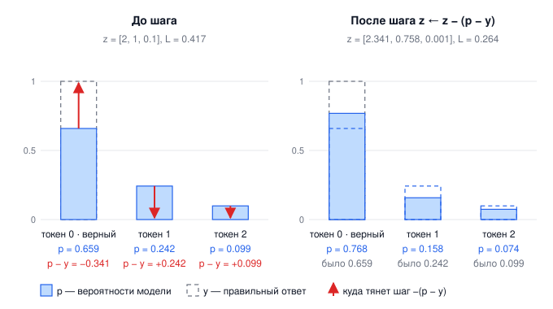

# L3. Градиенты, backprop и оптимизация

> **Цель лекции:** ответить на главный вопрос, который оставался открытым с вашего конспекта:
> **откуда берутся числа в W_Q, W_K, W_V?** Ответ: из оптимизации. Сначала с нуля вспомним производные и частные
> производные (с проверкой каждого правила на числах), затем поймём, как компьютер автоматически считает градиент
> по миллиардам параметров (backpropagation), и подробно, по шагам и на числах, разберём оптимизаторы:
> SGD, Momentum, RMSProp, Adam и AdamW — тот, которым обучают почти все современные LLM.
> Код: `ai_engineering/autograd` (скалярный autograd + тензорный для L4) и `ai_engineering/optim`.

---

## 1. Зачем это нужно

В L2 мы выяснили, что обучение языковой модели — это минимизация **функции потерь (loss)** — cross-entropy:
число, которое показывает, насколько плохо модель предсказывает следующий токен. Loss зависит от всех весов модели
(и от данных, на которых его считают, — но данные мы не меняем, мы меняем веса):

$$L = L(w_1, w_2, \dots, w_N), \qquad N \sim 10^9\text{–}10^{12}$$

Задача: найти такие w, при которых L минимален. Перебрать варианты невозможно — у нас миллиарды «ручек».
Решение, на котором стоит всё глубокое обучение:

1. Для каждой ручки wᵢ узнать: **если её чуть-чуть повернуть, loss вырастет или упадёт, и насколько сильно?**
   Это число называется **частной производной** ∂L/∂wᵢ, а вектор из всех таких чисел — **градиентом**.
2. Повернуть **все** ручки одновременно на маленький шаг в сторону уменьшения loss.
3. Повторить — сотни тысяч раз, каждый раз на свежей порции данных (у больших LLM ~10⁵–10⁶ шагов по миллиону
   токенов и больше на шаг).

Пункт 1 — это **backpropagation** (обратное распространение ошибки), пункты 2–3 — **оптимизатор**. Это вся лекция.

---

## 2. Производная: вспоминаем с нуля

### 2.1. Производная как наклон

### 📐 Математическая справка: что такое производная

Производная функции f в точке x показывает, **во сколько раз изменение выхода больше малого изменения входа**:
Δf ≈ f'(x)·Δx. Это не «во сколько раз вырастет f», а «сколько единиц выхода даёт единица входа»:

$$f'(x) = \lim_{h \to 0} \frac{f(x + h) - f(x)}{h}$$

| Символ | Как читать | Смысл |
|---|---|---|
| f'(x) или df/dx | «эф штрих от икс», «дэ эф по дэ икс» | производная f по x |
| h | «шаг» | крошечное изменение входа |
| f(x+h) − f(x) | «приращение функции» | на сколько изменился выход |
| lim₍h→0₎ | «предел при h, стремящемся к нулю» | берём h всё меньше и меньше и смотрим, к чему стремится дробь |

Дробь (изменение выхода)/(изменение входа) — это **наклон** прямой, проходящей через две близкие точки графика.
Когда h → 0, она превращается в наклон **касательной**.

**Пример:** f(x) = x², точка x = 3.

| h | f(3+h) | (f(3+h) − f(3)) / h |
|---|---|---|
| 1 | 16 | (16 − 9)/1 = 7 |
| 0.1 | 9.61 | 0.61/0.1 = 6.1 |
| 0.001 | 9.006001 | 0.006001/0.001 = 6.001 |

Дробь стремится к **6**. По правилу (x²)' = 2x получаем 2·3 = 6 ✓.

**Как понимать число 6:** «в окрестности x = 3, если увеличить x на 0.001, f вырастет примерно на 6·0.001 = 0.006».
Знак говорит о направлении: f' > 0 — функция растёт, f' < 0 — убывает, f' = 0 — плоское место (минимум, максимум
или «плато»).

> 💡 **Центральная разность** — более точный способ посчитать производную численно:
> (f(x+h) − f(x−h)) / 2h. Её ошибка O(h²) вместо O(h) у обычной разности. Для x² она вообще точна (6.000000 при
> любом h — у параболы нет третьей производной), поэтому разницу видно на eˣ в x = 0, где ответ 1, h = 0.01:
> обычная разность (e^{0.01} − 1)/0.01 = 1.00502 (ошибка 5·10⁻³), центральная (e^{0.01} − e^{−0.01})/0.02 = 1.0000167
> (ошибка 1.7·10⁻⁵ — в 300 раз меньше).
> Мы будем использовать её для проверки всех наших формул (**gradient check**).

### 2.2. Таблица производных, которые нам понадобятся

| f(x) | f'(x) | Пример: значение в x = 1 | Где в нейросетях |
|---|---|---|---|
| c (константа) | 0 | 0 | |
| x | 1 | 1 | |
| xⁿ | n·xⁿ⁻¹ | x³ → 3 | квадрат ошибки, RMSNorm |
| eˣ | eˣ | 2.718 | softmax |
| ln x | 1/x | 1 | cross-entropy |
| tanh x | 1 − tanh²x | 1 − 0.762² = 0.420 | активация (L4) |
| σ(x) = 1/(1+e⁻ˣ) | σ(x)·(1 − σ(x)) | 0.731·0.269 = 0.197 | гейты, SiLU |
| max(0, x) (ReLU) | 1 если x > 0, иначе 0 | 1 | активация (L4) |

### 2.3. Правила дифференцирования — каждое с проверкой

**Правило суммы:** (f + g)' = f' + g'.
Пример: f(x) = x² + 3x, в x = 2: f' = 2x + 3 = **7**.
Проверка: (f(2.001) − f(1.999))/0.002 = (10.007001 − 9.993001)/0.002 = **7.000** ✓.

**Правило произведения:** (f·g)' = f'·g + f·g'.
Пример: f(x) = x²·eˣ, в x = 1: f' = 2x·eˣ + x²·eˣ = 2e + e = 3e ≈ **8.1548**.
Проверка центральной разностью: **8.1549** ✓.

**Цепное правило (chain rule) — самое важное.** Если y = f(g(x)) — «функция от функции», то

$$\frac{dy}{dx} = \frac{dy}{dg} \cdot \frac{dg}{dx} = f'(g(x)) \cdot g'(x)$$

**Смысл:** изменения перемножаются по цепочке. Если g меняется в 3 раза быстрее x, а f меняется в 14 раз быстрее g,
то f меняется в 3·14 = 42 раза быстрее x.

Пример: y = (3x + 1)², в x = 2. Внутренняя функция g = 3x + 1 = 7, внешняя f = g².
- dg/dx = 3;
- dy/dg = 2g = 14;
- dy/dx = 14 · 3 = **42**.

Проверка: ((3·2.001+1)² − (3·1.999+1)²)/0.002 = **42.000** ✓.

Ещё пример: y = ln(1 + x²), в x = 1: g = 1 + x² = 2, dy/dg = 1/g = 0.5, dg/dx = 2x = 2, dy/dx = **1**. Проверка: 1.0000 ✓.

> **Нейросеть — это огромная «функция от функции от функции…»**: слой за слоем. Цепное правило позволяет
> посчитать, как loss зависит от веса в первом слое, перемножая локальные производные всех слоёв по пути.
> Backpropagation — это просто аккуратное применение цепного правила.

---

## 3. Частные производные и градиент

### 3.1. Функции многих переменных

Loss зависит не от одного числа, а от миллиардов. Начнём с двух: f(x, y).

### 📐 Математическая справка: частная производная

**Частная производная** ∂f/∂x («дэ эф по дэ икс», ∂ — «круглое д») — это обычная производная по x, **если считать
все остальные переменные константами**. Вопрос, на который она отвечает: «если двигать только x, а y заморозить,
как быстро меняется f?»

**Пример по шагам:** f(x, y) = x²·y + 3y в точке (2, 5).

*∂f/∂x* — замораживаем y (считаем его числом, например «5»):
- x²·y → y — константа-множитель, производная x² — это 2x → получаем 2x·y;
- 3y → не зависит от x вообще → 0.
- ∂f/∂x = 2xy = 2·2·5 = **20**.

*∂f/∂y* — замораживаем x:
- x²·y → x² — константа-множитель при y, (c·y)' = c → x²;
- 3y → 3.
- ∂f/∂y = x² + 3 = 4 + 3 = **7**.

Проверка центральными разностями:
- (f(2.001, 5) − f(1.999, 5))/0.002 = **20.000** ✓
- (f(2, 5.001) − f(2, 4.999))/0.002 = **7.000** ✓

Смысл: в точке (2, 5) функция в 20/7 ≈ 2.9 раза чувствительнее к x, чем к y.

**Как это выглядит.** Частная производная — это наклон «среза» функции: замораживаем одну переменную и получаем
обычную функцию одной переменной. Через точку (2, 5) проходят два среза:


- Слева y заморожен на 5: f(x, 5) = 5x² + 15 — парабола. Её наклон в x = 2 равен 10x = **20**.
- Справа x заморожен на 2: f(2, y) = 4y + 3y = 7y — прямая с наклоном **7**.

**Что значит «чувствительнее».** Речь не о том, что x меняется быстрее, чем y. x и y — входы, их сдвигаем мы сами,
и сдвигаем **на одну и ту же** крошечную величину. Чувствительность — это про **выход**: насколько сильно f
откликается на этот одинаковый толчок.

| Что сдвинули (на 0.001) | Новое f | Изменение f | Производная × 0.001 |
|---|---|---|---|
| ничего | f(2, 5) = 35 | — | — |
| только x: 2 → 2.001 | f(2.001, 5) = 35.020005 | **+0.020** | 20 · 0.001 = 0.020 |
| только y: 5 → 5.001 | f(2, 5.001) = 35.007 | **+0.007** | 7 · 0.001 = 0.007 |

Одинаковый сдвиг входа, а f изменилась на 0.020 против 0.007: в 20/7 ≈ 2.9 раза сильнее при сдвиге x.
На графике это разница наклонов: левая кривая в точке (2, 5) круче правой.

Три оговорки:
1. **Это свойство точки, а не функции.** В точке (0, 5): ∂f/∂x = 2·0·5 = **0**, ∂f/∂y = 0² + 3 = **3** — там f к
   малому сдвигу x вообще не чувствительна, а к y чувствительна. Обратите внимание: ∂f/∂x = 2xy зависит и от y.
   Переменные влияют друг на друга.
2. **Только для малых сдвигов.** Производная обещает: «сдвиг x на Δ меняет f на ≈ 20·Δ». Для Δ = 1 касательная
   (пунктир) даёт 35 + 20 = 55, а на самом деле f(3, 5) = 60. Парабола загибается вверх, и линейный прогноз
   портится тем сильнее, чем больше шаг. Поэтому в градиентном спуске шаги маленькие.
3. **Сравнивать можно, когда у входов одинаковые единицы.** Если бы x был в метрах, а y — в километрах, то
   «сдвиг на 0.001» значил бы разное. У весов нейросети единиц нет, но **масштабы** разные: коэффициенты
   нормализации порядка 1, веса линейных слоёв порядка 0.02, а их градиенты различаются на порядки. Поэтому
   «одинаковый шаг для всех» работает плохо, и в 6.4–6.5 появятся RMSProp и Adam — шаг под каждый параметр.

**Зачем это в обучении.** Если ∂L/∂w₁ = 20, а ∂L/∂w₂ = 7, то сейчас loss сильнее зависит от w₁. Градиентный
спуск сдвигает каждый вес пропорционально его производной, поэтому w₁ сдвинется в ≈ 2.9 раза сильнее, чем w₂.

### 3.2. Градиент

### 🔍 Формула под лупой: градиент

$$\nabla f = \left( \frac{\partial f}{\partial x_1}, \frac{\partial f}{\partial x_2}, \dots, \frac{\partial f}{\partial x_n} \right)$$

| Символ | Как читать | Смысл |
|---|---|---|
| ∇f | «набла эф», «градиент эф» | вектор из всех частных производных |
| ∂f/∂xᵢ | частная производная по i-й переменной | чувствительность f к i-й «ручке» |

Для примера выше ∇f(2, 5) = (20, 7).


Это вид на ту же функцию сверху: каждая линия соединяет точки с одинаковым значением f, как горизонтали на
топографической карте. Синяя и оранжевая стрелки — шаги только по x и только по y, их «силу» задают частные
производные 20 и 7. Красная стрелка — градиент (20, 7): сумма этих двух направлений с весами 20 и 7. Он почти
горизонтален, потому что по x функция в ≈ 2.9 раза чувствительнее.

Ещё одно свойство видно на картинке: градиент **перпендикулярен** линии уровня f = 35. Проверим на числах. Линия
f = 35 — это y = 35/(x² + 3). Её наклон в x = 2: dy/dx = −2·35·x/(x² + 3)² = −140/49 ≈ −2.857, то есть
направление линии — (1, −2.857). Скалярное произведение с градиентом: 20·1 + 7·(−2.857) = 20 − 20 = **0**, значит
векторы перпендикулярны ✓. Вдоль линии уровня f не меняется, а быстрее всего f растёт поперёк неё.

**Главное свойство:** градиент указывает **направление наискорейшего роста** функции, а его длина — скорость
этого роста. Значит, **−∇f — направление наискорейшего убывания**. Отсюда весь метод градиентного спуска.

**Проверка на числах.** f(x, y) = x² + 2y², точка (1, 1), f = 3. Градиент: ∂f/∂x = 2x = 2, ∂f/∂y = 4y = 4,
∇f = (2, 4), длина ‖∇f‖ = √(4 + 16) = √20 ≈ 4.472.
Сдвинемся на расстояние 0.01 в разных направлениях и посмотрим, насколько вырастет f:

| Направление (единичный вектор) | Рост f |
|---|---|
| вдоль оси x: (1, 0) | 0.0201 |
| по диагонали: (0.707, 0.707) | 0.0426 |
| вдоль оси y: (0, 1) | 0.0402 |
| **вдоль градиента: (2, 4)/4.472 = (0.447, 0.894)** | **0.0449** ← максимум |

Рост вдоль градиента ≈ ‖∇f‖·0.01 = 0.0447 — длина градиента и есть «скорость подъёма».

**Почему максимум именно вдоль градиента.** Сдвиг на малое ε в направлении единичного вектора u меняет f на
≈ ε·(∇f·u) — сумму «вклад по x + вклад по y». Скалярное произведение ∇f·u = ‖∇f‖·‖u‖·cos θ = ‖∇f‖·cos θ, где θ —
угол между u и градиентом. Оно максимально при cos θ = 1, то есть при u, направленном вдоль ∇f (неравенство
Коши–Буняковского). Числа:
- вдоль x: ∇f·u = 2·1 + 4·0 = 2 → рост ≈ 0.020 (в таблице 0.0201);
- по диагонали: 2·0.707 + 4·0.707 = 4.243 → 0.0424 (в таблице 0.0426), cos θ = 4.243/4.472 = 0.949;
- вдоль градиента: cos θ = 1 → 4.472 → 0.0447 (в таблице 0.0449).

Небольшие расхождения с таблицей — вклад кривизны (второго порядка, ~ε²), который линейная оценка не учитывает.

### 3.3. Градиентный спуск на этом примере

Правило обновления (вывод — в разделе 6):

$$\mathbf{w} \leftarrow \mathbf{w} - \eta \cdot \nabla f(\mathbf{w})$$

η («эта») — **learning rate**, размер шага. Возьмём η = 0.1, старт (1, 1):

| Шаг | (x, y) | ∇f = (2x, 4y) | f |
|---|---|---|---|
| 0 | (1, 1) | (2, 4) | 3 |
| 1 | (1 − 0.2, 1 − 0.4) = (0.8, 0.6) | (1.6, 2.4) | 1.36 |
| 2 | (0.64, 0.36) | (1.28, 1.44) | 0.669 |
| 3 | (0.512, 0.216) | (1.024, 0.864) | 0.355 |

Обратите внимание: y уменьшается быстрее x (в 0.6 раза за шаг против 0.8), потому что функция круче по y.

**Почему это проблема.** За шаг x умножается на (1 − 2η), а y — на (1 − 4η). Размер шага ограничивает **самое
крутое** направление: при η = 0.5 множитель по y равен −1 (y прыгает 1 → −1 → 1… вечно), при η > 0.5 y расходится.
Здесь крутизны различаются всего в 2 раза, и это не страшно. Возьмём f = x² + 50y²: по y множитель (1 − 100η),
значит, нужно η < 0.02. Но тогда по x множитель не меньше 1 − 2·0.02 = 0.96, и чтобы уменьшить x в 1000 раз,
нужно ln 1000 / (−ln 0.96) ≈ **169** шагов. Отношение максимальной кривизны к минимальной (**число обусловленности**)
в нейросетях — тысячи и больше. Это «овраг»: крутые стенки диктуют маленький шаг, а вдоль пологого дна мы ползём.
С ним будут бороться Momentum и Adam (раздел 6).

---

## 4. Вычислительный граф и обратный проход вручную

### 4.1. Граф

Любое выражение можно разложить на элементарные операции. L = (a·b + c)·f при a = 2, b = −3, c = 10, f = −2:

```
  a=2 ──┐
        (×)── e=−6 ──┐
  b=−3 ─┘            (+)── d=4 ──┐
            c=10 ────┘           (×)── L=−8
                       f=−2 ─────┘
```

Здесь f — просто имя переменной (как в micrograd), а не функция.

**Forward (прямой проход):** считаем слева направо: e = a·b = −6, d = e + c = 4, L = d·f = −8.

### 4.2. Backward (обратный проход)

Хотим ∂L/∂(каждой переменной). Идём **справа налево**, используя цепное правило: градиент узла =
(градиент его выхода) × (локальная производная).

Локальные производные элементарных операций:
- **сложение** z = x + y: ∂z/∂x = 1, ∂z/∂y = 1 — градиент **копируется** на оба входа;
- **умножение** z = x·y: ∂z/∂x = y, ∂z/∂y = x — каждый вход получает градиент × **другой** вход.

| Узел | Как считаем | ∂L/∂узел |
|---|---|---|
| L | по определению | **1** |
| d | L = d·f → ∂L/∂d = f | **−2** |
| f | L = d·f → ∂L/∂f = d | **4** |
| c | d = e + c → ∂L/∂c = ∂L/∂d · 1 | **−2** |
| e | d = e + c → ∂L/∂e = ∂L/∂d · 1 | **−2** |
| a | e = a·b → ∂L/∂a = ∂L/∂e · b = −2·(−3) | **6** |
| b | e = a·b → ∂L/∂b = ∂L/∂e · a = −2·2 | **−4** |

**Смысл:** если увеличить a на 0.01, L изменится на ≈ 6·0.01 = +0.06. Проверим: a = 2.01 → e = −6.03, d = 3.97,
L = −7.94. Было −8, стало −7.94: +0.06 ✓.

Эта таблица — ровно тест `TestScalarLectureExample` в пакете `autograd`.

### 4.3. Важная деталь: если узел используется дважды, градиенты складываются

y = x·x при x = 3. Через умножение: ∂y/∂(первый x) = второй x = 3, ∂y/∂(второй x) = 3. Это один и тот же x,
поэтому **сумма**: 3 + 3 = 6 = 2x ✓. В коде это `a.Grad += …` (а не `=`). Забыть «+=» — классический баг
самописного autograd. Тест `TestScalarReuseAccumulates`.

### 4.4. Почему именно «обратный» режим

Можно было бы идти слева направо (forward-mode): «как всё зависит от a?» — один проход на **каждый** вход.
Для N = 10⁹ параметров — 10⁹ проходов. Обратный режим (reverse-mode) за **один** проход назад даёт производные
одного выхода (loss) по **всем** входам. У нас ровно такой случай: один скалярный loss, миллиарды параметров.
Цена по памяти: нужно хранить все промежуточные значения прямого прохода (активации) — главный потребитель памяти
при обучении.

Цена по вычислениям: backward стоит ≈ 2 forward. Для умножения матриц это видно сразу: forward — одно произведение
A·B, backward — два (G·Bᵀ и Aᵀ·G, раздел 5). Весь шаг обучения ≈ 3 forward. Forward стоит ≈ 2 FLOP на параметр на
токен (умножение + сложение), отсюда оценка стоимости обучения **6·N·D** FLOP, где D — число токенов. Модель
N = 7·10⁹ на D = 10¹² токенов: 6·7·10⁹·10¹² = 4.2·10²² FLOP (подробнее — L11).

### 4.5. Алгоритм в коде

1. **Топологическая сортировка** графа: порядок, в котором каждый узел идёт после всех своих входов.
2. Градиент выхода = 1.
3. Идём по узлам **в обратном порядке**; каждый узел вызывает свою функцию `backward`, которая добавляет
   (выход.grad × локальная производная) к grad своих входов.

Обратный топологический порядок гарантирует, что к моменту обработки узла **все** вклады в его градиент уже
собраны (из всех мест, где он использовался).

Две детали, на которых ломается самописный autograd:
- **Каждый узел — в порядке ровно один раз.** Сортировка (обход в глубину) помнит посещённые узлы (`seen`).
  Без этого узел x из y = x·x попадёт в порядок дважды, его backward вызовется дважды, и все градиенты
  ниже него удвоятся. Это второй классический баг рядом с `=` вместо `+=`.
- **Кто обнуляет Grad.** `Scalar.Backward` сам обнуляет Grad у всех узлов графа перед проходом — удобно для
  ручных примеров: два вызова подряд дают тот же ответ. Тензорный `Var.Backward` обнуляет только промежуточные
  узлы, а **параметры накапливают** градиент между вызовами (тест `TestGradAccumulatesAcrossBackward`: два
  Backward для w·w при w = 3 дают 6 + 6 = 12). Обнуляет их явный `opt.ZeroGrad()` — зачем так сделано, см. раздел 7.

```go
// Mul: d(a·b)/da = b, d(a·b)/db = a — каждый вход получает "другой" вход × upstream-градиент.
func (a *Scalar) Mul(b *Scalar) *Scalar {
	out := newScalar(a.Data*b.Data, "*", a, b)
	out.backward = func() {
		a.Grad += b.Data * out.Grad
		b.Grad += a.Data * out.Grad
	}
	return out
}
```

---

## 5. Градиенты матричных операций

В нейросети узлы графа — не числа, а тензоры. Нужны правила для matmul и softmax.

Карта раздела — последний слой языковой модели: активации X умножаются на матрицу W, получаются логиты Z, из них
softmax и cross-entropy дают loss. Backward идёт обратно, и на каждой стрелке стоит формула, которую мы выведем ниже.


Читать справа налево:
1. У L градиент 1 (по определению).
2. Через softmax + cross-entropy он превращается в G = (P − Y)/n — градиент по логитам (вывод — ниже, «p − y»).
3. Через MatMul G расходится на два входа: в веса (Xᵀ·G — то, что обновит оптимизатор) и в активации (G·Wᵀ — то,
   что уйдёт дальше назад, в предыдущий слой).

### 🔍 Формула под лупой: градиент умножения матриц

Пусть C = A·B (A: n × k, B: k × p), и мы знаем G = ∂L/∂C (матрица той же формы, что C: «как loss зависит от
каждого элемента C»). Тогда:

$$\frac{\partial L}{\partial A} = G \cdot B^\top \qquad \frac{\partial L}{\partial B} = A^\top \cdot G$$

**Вывод через индексы** (то же цепное правило, только с суммами). Элемент cᵢⱼ = Σₗ aᵢₗ bₗⱼ.
От какого aᵢₗ зависит какой c? Элемент aᵢₗ входит только в строку i результата: во все cᵢⱼ, j = 1…p, с
коэффициентом bₗⱼ (∂cᵢⱼ/∂aᵢₗ = bₗⱼ). По цепному правилу суммируем все пути:

$$\frac{\partial L}{\partial a_{il}} = \sum_{j} \frac{\partial L}{\partial c_{ij}} \cdot \frac{\partial c_{ij}}{\partial a_{il}} = \sum_j g_{ij} \, b_{lj} = (G B^\top)_{il}$$

Последнее равенство — это определение произведения G на Bᵀ (элемент (i, l) = строка i из G · строка l из B). ∎

**Проверка формой:** ∂L/∂A должно иметь форму A (n × k). G·Bᵀ: (n × p)(p × k) = n × k ✓. Это лучший способ
вспомнить формулу: «транспонировать так, чтобы сошлись формы».

**Пример 2 × 2:** A = [[1, 2], [3, 4]], B = [[5, 6], [7, 8]].

Сначала forward. Каждый элемент C — строка A, скалярно умноженная на столбец B: cᵢⱼ = (строка i из A) · (столбец j
из B), то есть пары чисел перемножаются по порядку, а произведения складываются. Строки A: (1, 2) и (3, 4);
столбцы B: (5, 7) и (6, 8).

| Элемент | Строка A | Столбец B | Расчёт | Итог |
|---|---|---|---|---|
| c₁₁ | (1, 2) | (5, 7) | 1·5 + 2·7 = 5 + 14 | **19** |
| c₁₂ | (1, 2) | (6, 8) | 1·6 + 2·8 = 6 + 16 | **22** |
| c₂₁ | (3, 4) | (5, 7) | 3·5 + 4·7 = 15 + 28 | **43** |
| c₂₂ | (3, 4) | (6, 8) | 3·6 + 4·8 = 18 + 32 | **50** |

C = [[19, 22], [43, 50]]. Возьмём L = сумма всех элементов C = 19 + 22 + 43 + 50 = 134. Каждый элемент входит в
сумму с коэффициентом 1, значит G = ∂L/∂C = [[1, 1], [1, 1]].

$$\frac{\partial L}{\partial A} = G B^\top = \begin{pmatrix}1&1\\1&1\end{pmatrix}\begin{pmatrix}5&7\\6&8\end{pmatrix} = \begin{pmatrix}11&15\\11&15\end{pmatrix}, \qquad \frac{\partial L}{\partial B} = A^\top G = \begin{pmatrix}4&4\\6&6\end{pmatrix}$$

Проверка смыслом: по таблице a₁₁ = 1 входит только в первую строку C — в c₁₁ = **a₁₁**·5 + a₁₂·7 и в
c₁₂ = **a₁₁**·6 + a₁₂·8. Увеличим a₁₁ на 1: c₁₁ вырастет на 5, c₁₂ — на 6, сумма C — на 5 + 6 = **11** ✓. Тест `TestMatMulGradLectureExample`.


Верхний ряд — forward: a₁₁ попадает в два элемента C с множителями 5 и 6. Нижний — backward: те же 11 получаются
как (строка 1 из G) · (столбец 1 из Bᵀ), а столбец 1 из Bᵀ — это и есть строка 1 из B, те же 5 и 6. Транспонирование
в формуле — не трюк, а способ «достать» нужные множители. Внизу — правило форм: внутренние размеры обязаны совпасть.

**От 2 × 2 к слою языковой модели.** Линейный слой трансформера умножает активации X формы (батч, позиции,
каналы_вход) на одну матрицу весов W (каналы_вход × каналы_выход). Все ведущие оси сплющиваются в одну: X
превращается в матрицу из n = батч·позиции строк, по строке на токен, и работают те же формулы: dX = G·Wᵀ,
dW = Xᵀ·G. Произведение Xᵀ·G — это **сумма по всем токенам** вкладов «строка X, транспонированная, × строка G»:
одна матрица W использована на каждой позиции, и вклады складываются (правило 4.3). В примере выше строки A — два
«токена»: токен 1 даёт [1, 2]ᵀ·[1, 1] = [[1, 1], [2, 2]], токен 2 — [3, 4]ᵀ·[1, 1] = [[3, 3], [4, 4]], сумма
[[4, 4], [6, 6]] = AᵀG ✓. В коде этот случай — `matMulShared` в `ops.go`.

**Broadcasting в обратную сторону.** Если вектор bias β формы (d,) прибавили к каждой строке матрицы X формы
(n, d), то каждый элемент β использован n раз — его градиент — **сумма** градиентов по всем n строкам (правило 4.3).
Пример: X из 2 строк по 3 элемента, L = сумма всех элементов X + β → ∂L/∂β = (1 + 1, 1 + 1, 1 + 1) = (2, 2, 2).
В коде это функция `reduceTo` (тест `TestBroadcastAddReducesGrad`).

### 🔍 Формула под лупой: softmax + cross-entropy → p − y

Это **самая важная производная в языковых моделях** — её считают на каждой позиции каждого шага обучения.

Дано: логиты z = (z₁, …, z_V), правильный токен t. Softmax: pₖ = e^{zₖ} / Σⱼ e^{zⱼ}. Loss (из L2):

$$L = -\ln p_t = -z_t + \ln \sum_j e^{z_j}$$

(второе равенство: ln(e^{z_t}/S) = z_t − ln S, где S = Σⱼ e^{zⱼ}.)

Берём частную производную по zₖ, по частям:
- **первое слагаемое** −z_t: если k = t, производная −1, иначе 0. Запишем это как −yₖ, где y — one-hot вектор
  (yₖ = 1 при k = t, иначе 0);
- **второе слагаемое** ln S: по цепному правилу (ln S)' = (1/S) · ∂S/∂zₖ, а ∂S/∂zₖ = e^{zₖ} (в сумме от zₖ зависит
  только одно слагаемое). Итого e^{zₖ}/S = **pₖ**.

$$\boxed{\frac{\partial L}{\partial z_k} = p_k - y_k}$$

**Смысл:** «вероятность, которую модель дала, минус вероятность, которую надо было дать». Для правильного токена
градиент отрицательный (его логит будут **повышать**), для остальных — положительный (их **понижать**), пропорционально
тому, насколько модель на них ошибочно «поставила».

**Пример:** z = [2, 1, 0.1], правильный токен — первый (t = 0).

| | токен 0 | токен 1 | токен 2 |
|---|---|---|---|
| e^z | 7.389 | 2.718 | 1.105 |
| p (сумма 11.212) | 0.659 | 0.242 | 0.099 |
| y | 1 | 0 | 0 |
| **∂L/∂z = p − y** | **−0.341** | **0.242** | **0.099** |

L = −ln 0.659 = **0.417**. Тест `TestCrossEntropyLectureExample`.

Что сделает один шаг градиентного спуска z ← z − η·(p − y) с η = 1:



Логит верного токена вырос на 0.341, остальные упали на 0.242 и 0.099: z = [2.341, 0.758, 0.001]. Вероятность
верного токена поднялась 0.659 → 0.768, loss упал 0.417 → 0.264. Красные стрелки слева — это ровно p − y, взятое со
знаком минус: каждая тянет столбик от p к y, и длина стрелки — величина ошибки.

**Два свойства p − y, которые стоит запомнить.**
1. **Сумма компонент равна нулю:** Σₖ(pₖ − yₖ) = 1 − 1 = 0. В примере: −0.341 + 0.242 + 0.099 = 0 ✓. Причина: если
   прибавить одно и то же число ко всем логитам, softmax не изменится, значит, и loss не изменится, — градиент
   не может «тянуть» все логиты вверх или вниз разом.
2. **Каждая компонента по модулю не больше 1:** pₖ и yₖ лежат в [0, 1]. Градиент по логитам ограничен при любых
   данных — один «плохой» пример сам по себе его не взорвёт. Взрывы градиентов рождаются глубже, при
   перемножении локальных производных многих слоёв (отсюда clipping в 6.8).

**От одного токена к батчу.** Реальный loss LLM — среднее по всем n = батч·позиции предсказаниям:
L = (1/n)·Σᵢ Lᵢ. Каждое Lᵢ зависит только от своих логитов, поэтому ∂L/∂zᵢ = (pᵢ − yᵢ)/n. Если тот же пример
повторить на двух позициях (n = 2), градиент по логитам каждой позиции — (−0.1705, 0.1212, 0.0493), вдвое меньше.
В коде это множитель `scale = 1/count` в `CrossEntropy`; позиции с целью < 0 в среднее не входят.

### 🔍 Формула под лупой: softmax отдельно (якобиан)

В attention softmax стоит **без** cross-entropy, и его backward нужен сам по себе. У softmax V входов и V выходов,
поэтому производная — матрица V × V (**якобиан**): как каждый выход pᵢ зависит от каждого входа zⱼ. По правилу
дроби для pᵢ = e^{zᵢ}/S:
- i = j: (e^{zᵢ}·S − e^{zᵢ}·e^{zᵢ})/S² = pᵢ − pᵢ²;
- i ≠ j: числитель от zⱼ не зависит, остаётся −e^{zᵢ}·e^{zⱼ}/S² = −pᵢ·pⱼ.

$$\frac{\partial p_i}{\partial z_j} = p_i(\delta_{ij} - p_j), \qquad \delta_{ij} = \begin{cases}1, & i = j\\ 0, & i \ne j\end{cases}$$

На числах (z = [2, 1, 0.1], p = (0.659, 0.242, 0.099)): ∂p₀/∂z₀ = 0.659·0.341 = 0.2247, ∂p₀/∂z₁ = −0.659·0.242 =
−0.1598. Проверка: z₀ = 2 → 2.01 сдвигает p₀ на +0.00224 ≈ 0.2247·0.01 ✓. Знаки понятны: поднял свой логит —
своя вероятность выросла, чужие упали.

Якобиан целиком строить нельзя: при словаре V = 50 000 это 2.5·10⁹ чисел на **каждую** позицию. Backward нужен
только в виде «градиент выхода g = ∂L/∂p → градиент входа»:

$$\frac{\partial L}{\partial z_j} = \sum_i g_i\, p_i(\delta_{ij} - p_j) = p_j\left(g_j - \sum_i g_i p_i\right)$$

Это O(V) операций: одно скалярное произведение ⟨g, p⟩ и поэлементная формула. Ровно так написан `Softmax` в `ops.go`.

**Замыкаем круг.** Пропустим через эту формулу cross-entropy: L = −ln p_t, значит gᵢ = ∂L/∂pᵢ = −yᵢ/pᵢ
(для правильного токена −1/p_t, для остальных 0). Тогда ⟨g, p⟩ = −1/p_t · p_t = −1, и
∂L/∂zⱼ = pⱼ(−yⱼ/pⱼ + 1) = pⱼ − yⱼ — тот же p − y, вторым путём. На числах: g = (−1/0.659, 0, 0) = (−1.517, 0, 0),
⟨g, p⟩ = −1, ∂L/∂z = (0.659·(−1.517 + 1), 0.242·1, 0.099·1) = (−0.341, 0.242, 0.099) ✓.

**Численная стабильность.** Формулы выше верны математически, но при z = [1000, 0] наивный e^{1000} переполняет
даже float64 (предел ≈ e^{709}). Лекарство — вычесть максимум: softmax(z) = softmax(z − m), m = maxⱼ zⱼ (числитель
и знаменатель делятся на одно и то же e^m). Для loss — **logsumexp**: ln S = m + ln Σⱼ e^{zⱼ − m}. Пример:
z = [1000, 0], правильный токен второй: ln S = 1000 + ln(1 + e^{−1000}) = 1000, L = ln S − z_t = 1000 − 0 = **1000**.
Наивный путь «посчитать p, потом −ln p» даёт p₁ = e^{−1000} → 0 в машинной арифметике и L = −ln 0 = ∞.
Поэтому loss считают как ln S − z_t, а не как −ln(softmax): softmax и cross-entropy **сливают** в одну операцию.
В нашем коде `softmaxRow` вычитает максимум.

### Gradient check

Каждую формулу backward мы проверяем численно: шевелим каждый параметр на ±ε, считаем
(L(θ+ε) − L(θ−ε))/2ε и сравниваем с аналитическим градиентом. Метрика — относительная ошибка:

$$\text{rel} = \frac{|g_\text{analytic} - g_\text{numeric}|}{\max\left(|g_\text{analytic}| + |g_\text{numeric}|,\ 10^{-3}\right)}$$

Нижний порог 10⁻³ в знаменателе нужен для градиентов, равных нулю: без него 0/0. Пример: аналитический 0.2000,
численный 0.2004 → rel = 0.0004/0.4004 ≈ 10⁻³ — норма.

**Почему ε = 10⁻², а не «как можно меньше».** У центральной разности две ошибки, и они тянут в разные стороны:
- **усечение** — отброшенные члены ряда Тейлора, растут как ε² (большой ε — грубая секущая);
- **округление** — L(θ+ε) и L(θ−ε) почти равны, и при вычитании теряются значащие цифры; эта ошибка, делённая на
  2ε, растёт как 1/ε.


График посчитан нашим кодом на примере cross-entropy выше: оранжевая кривая — `GradCheck` во float32, как в
тестах, синяя — то же во float64 на `Scalar`. У float64 минимум около ε ≈ 2·10⁻⁵ с ошибкой ~10⁻¹¹. У float32
(7 значащих цифр против 16) округление примерно в 5·10⁸ раз грубее, и минимум сдвигается к ε ≈ 4·10⁻³ — поэтому в тестах
ε = 10⁻². При ε ≲ 10⁻⁷ во float32 сдвиг θ ± ε вообще теряется при округлении: L(θ+ε) = L(θ−ε), численный градиент
равен 0, ошибка 100 %. Справа обе кривые совпадают: усечению всё равно, в какой точности считать.

На одной cross-entropy ошибка при ε = 10⁻² — около 10⁻⁵. У составных графов из тестов она больше. В
`TestGradCheckOps` (ε = 10⁻²) измеренные ошибки — от 4·10⁻⁵ (`sub-mul-div`) до 1.5·10⁻² (`add-broadcast`). Худший
случай — большой loss (сумма 24 квадратов) при малых градиентах отдельных элементов: округление loss во float32
(~10⁻⁷–10⁻⁶ от его величины), делённое на 2ε, сравнимо с самим градиентом. Тест падает при rel > 5·10⁻² — запас в 3 раза над худшим честным случаем. Ошибка
порядка 10⁻¹ и больше почти всегда означает баг. Функция `autograd.GradCheck`, тест `TestGradCheckOps` проверяет все гладкие операции пакета.
Исключение — ReLU: в точке излома 0 конечная разность «перешагивает» его и врёт, поэтому для ReLU отдельный
`TestReLUGrad`. Операции трансформера проверяет `TestGradCheckTransformerOps`.

---

## 6. Оптимизаторы: от градиентного спуска к AdamW

Сквозной пример для всех оптимизаторов — функция одного параметра:

$$f(w) = (w - 3)^2, \qquad f'(w) = 2(w - 3), \qquad w_0 = 0, \quad \text{минимум в } w^* = 3$$

### 6.1. Градиентный спуск (GD)

### 🔍 Формула под лупой

$$w_{t+1} = w_t - \eta \cdot g_t, \qquad g_t = \nabla L(w_t)$$

| Символ | Смысл |
|---|---|
| w_t | веса на шаге t |
| g_t | градиент loss в текущей точке |
| η | learning rate (скорость обучения) — длина шага |
| минус | идём **против** градиента — туда, где loss убывает |

**Почему это работает (формула Тейлора):** около текущей точки L(w + Δ) ≈ L(w) + g·Δ. Если взять Δ = −ηg, то
L(w − ηg) ≈ L(w) − η·g² — loss **уменьшается** (g² ≥ 0), пока шаг маленький.

**На числах, η = 0.1:**

| t | w | f(w) | g = 2(w − 3) | новый w = w − 0.1·g | f(новый w) |
|---|---|---|---|---|---|
| 0 | 0 | 9 | −6 | 0.6 | 5.76 |
| 1 | 0.6 | 5.76 | −4.8 | 1.08 | 3.69 |
| 2 | 1.08 | 3.69 | −3.84 | 1.464 | 2.36 |

**Выбор learning rate.** Здесь можно посчитать точно: w − 3 после шага = (w − 3)(1 − 2η).
- η = 0.1: расстояние до минимума × 0.8 за шаг — медленно, но верно;
- η = 0.5: × 0 — попадаем в минимум за один шаг;
- η = 1.0: × (−1) — прыгаем 0 → 6 → 0 → 6… вечно;
- η = 1.1: × (−1.2) — **расходимся**: расстояние 3 → 3.6 → 4.32 → …

Это и есть «loss взорвался» на практике: learning rate слишком велик для кривизны функции.

### 6.2. Стохастический градиентный спуск (SGD)

Loss по всем данным — среднее по N примерам: L(w) = (1/N) Σᵢ ℓᵢ(w). Точный градиент требует пройти **весь датасет**
(триллионы токенов!) ради одного шага. SGD берёт **случайную мини-выборку (batch)** из B примеров и считает градиент
только по ней:

$$g_t = \frac{1}{B} \sum_{i \in \text{batch}} \nabla \ell_i(w_t)$$

**Пример:** 4 примера с ℓᵢ = (w − yᵢ)², y = [1, 2, 3, 6], w = 0. Градиент примера: 2(w − yᵢ).
- Полный градиент: 2·(0 − 3) = **−6** (среднее y = 3).
- Батч {1, 2}: 2·(0 − 1.5) = **−3**; батч {3, 6}: 2·(0 − 4.5) = **−9**.
- Среднее по двум батчам: (−3 − 9)/2 = −6 ✓.

Градиент по батчу — **шумная, но несмещённая** оценка полного: в среднем он правильный. Шум уменьшается как
1/√B. Плюсы: шаг в тысячи раз дешевле; шум помогает выбираться из плохих узких минимумов. «Стохастический» =
«случайный»: именно случайность выбора батча.

> В современной терминологии «SGD» означает сам приём «шаг по градиенту мини-батча», а **Adam/AdamW — это тоже
> стохастические оптимизаторы**: они получают тот же шумный g_t, но по-умному решают, **куда и насколько** шагнуть.

### 6.3. Momentum (инерция)

Проблема GD — в «оврагах» (как x² + 50y² из 3.3, а в нейросетях — с разницей кривизны в тысячи раз) он колеблется
поперёк оврага и медленно ползёт вдоль. Идея — шарик с инерцией: накапливаем **скорость**.

### 🔍 Формула под лупой

$$v_t = \beta \cdot v_{t-1} + g_t, \qquad w_{t+1} = w_t - \eta \cdot v_t$$

| Символ | Смысл |
|---|---|
| v_t | «скорость» — накопленная сумма прошлых градиентов |
| β | коэффициент инерции (обычно 0.9): какая доля старой скорости сохраняется |

Раскрыв рекурсию: v_t = g_t + β g_{t−1} + β² g_{t−2} + … — **экспоненциально затухающая сумма** градиентов.
При β = 0.9 «эффективная память» ≈ 1/(1 − β) = 10 шагов. Градиенты, которые стабильно указывают в одну сторону,
**складываются** (разгон до 10× при β = 0.9), а скачущие ±, **гасят друг друга**.

**На числах, η = 0.1, β = 0.9:**

| t | w | g | v = 0.9·v + g | новый w = w − 0.1·v |
|---|---|---|---|---|
| 1 | 0 | −6 | −6 | 0.6 |
| 2 | 0.6 | −4.8 | 0.9·(−6) − 4.8 = −10.2 | 1.62 |
| 3 | 1.62 | −2.76 | 0.9·(−10.2) − 2.76 = −11.94 | 2.814 |

После 3 шагов w = 2.814 против 1.464 у GD — почти у цели (но инерция пронесёт мимо, и будут затухающие колебания).
Почему проносит: при постоянном градиенте v разгоняется до g/(1 − β) = 10g, то есть **эффективный** шаг —
η/(1 − β) = 0.1/0.1 = 1.0, в 10 раз больше номинального. Отсюда перелёт через минимум. Подбирая η для Momentum,
помните об этом множителе. В Adam (6.5) m — среднее, а не сумма, и такого ×10 нет.

### 6.4. RMSProp: свой шаг для каждого параметра

Проблема: у разных параметров градиенты разного масштаба (эмбеддинг редкого токена получает градиент раз в 1000 шагов,
а bias — каждый шаг). Один η для всех плох. Идея: делить шаг на **типичный размер градиента этого параметра**.

### 🔍 Формула под лупой

$$s_t = \beta \cdot s_{t-1} + (1-\beta) \cdot g_t^2, \qquad w_{t+1} = w_t - \eta \cdot \frac{g_t}{\sqrt{s_t} + \varepsilon}$$

| Символ | Смысл |
|---|---|
| g_t² | квадрат градиента (поэлементно) |
| s_t | скользящее среднее квадратов — «типичный g²» |
| √s_t | «типичный размер» градиента (RMS — root mean square, корень из среднего квадрата) |
| ε | крошечное число (10⁻⁸), чтобы не делить на 0 |

Шаг ≈ η · g/|типичный g| — **безразмерный**, порядка η, независимо от масштаба градиента.

**На числах (η = 0.1, β = 0.9):** шаг 1: g = −6, s = 0.1·36 = 3.6, √s = 1.897, шаг = 0.1·6/1.897 = 0.316 → w = 0.316.
Шаг 2: g = −5.37, s = 0.9·3.6 + 0.1·28.81 = 6.12, w = 0.533. Шаг 3: w = 0.708.

Шаги 0.316, 0.217, 0.175 — меньше, чем у GD (0.6, 0.48, 0.38): RMSProp делит на |g| и делает шаг ≈ η, хотя
здесь |g| = 6. Первые шаги при этом даже **завышены**: s стартует с нуля и занижен, √s мал, и шаг больше «честного» в
1/√(1 − βᵗ) раз — на шаге 1 в 1/√0.1 = 3.16 раза (0.316 вместо 0.1). Это исправит bias correction в Adam: там
первый шаг будет ровно η = 0.1. (В коде `NewRMSProp` по умолчанию β = 0.99; в примере и тесте `TestRMSProp` — 0.9.)

### 6.5. Adam = Momentum + RMSProp + поправка на старт

### 🔍 Формула под лупой: Adam (каждый член)

$$m_t = \beta_1 m_{t-1} + (1-\beta_1)\, g_t \qquad\qquad (1)\ \text{«среднее градиента» (импульс)}$$
$$v_t = \beta_2 v_{t-1} + (1-\beta_2)\, g_t^2 \qquad\qquad (2)\ \text{«среднее квадрата» (масштаб)}$$
$$\hat m_t = \frac{m_t}{1-\beta_1^t}, \qquad \hat v_t = \frac{v_t}{1-\beta_2^t} \qquad (3)\ \text{bias correction}$$
$$w_{t+1} = w_t - \eta \cdot \frac{\hat m_t}{\sqrt{\hat v_t} + \varepsilon} \qquad\qquad (4)\ \text{шаг}$$

| Символ | Типичное значение | Смысл |
|---|---|---|
| m_t | старт 0 | «первый момент»: сглаженное направление (как Momentum, но среднее, а не сумма) |
| v_t | старт 0 | «второй момент»: сглаженный g² (как RMSProp) |
| β₁ | 0.9 | память m ≈ 10 шагов |
| β₂ | 0.999 (в LLM часто 0.95) | память v ≈ 1000 (20) шагов |
| β₁ᵗ | β₁ в степени t | на шаге 1: 0.9, на шаге 10: 0.35, на шаге 100: ≈ 0 |
| m̂, v̂ | | исправленные оценки (см. ниже) |
| ε | 10⁻⁸ | защита от деления на 0 |

**Зачем bias correction (3).** m и v стартуют с нуля. На шаге 1: m₁ = 0.1·g₁ — в 10 раз меньше реального градиента!
Это не свойство данных, а артефакт нулевого старта. Деление на (1 − β₁ᵗ) = (1 − 0.9) = 0.1 как раз возвращает m̂₁ = g₁.
С ростом t знаменатель → 1, и поправка перестаёт действовать. Для v эффект ещё сильнее: (1 − 0.999) = 0.001.

**На числах (η = 0.1, β₁ = 0.9, β₂ = 0.999), f(w) = (w − 3)²:**

| | шаг 1 | шаг 2 | шаг 3 |
|---|---|---|---|
| w до шага | 0 | 0.1 | 0.19990 |
| g = 2(w − 3) | −6 | −5.8 | −5.6002 |
| m = 0.9m + 0.1g | −0.6 | 0.9·(−0.6) + 0.1·(−5.8) = −1.12 | −1.5680 |
| v = 0.999v + 0.001g² | 0.036 | 0.999·0.036 + 0.001·33.64 = 0.069604 | 0.100897 |
| 1 − β₁ᵗ | 0.1 | 0.19 | 0.271 |
| 1 − β₂ᵗ | 0.001 | 0.001999 | 0.002997 |
| m̂ = m/(1 − β₁ᵗ) | −6 | −5.8947 | −5.7861 |
| v̂ = v/(1 − β₂ᵗ) | 36 | 34.819 | 33.666 |
| шаг = η·m̂/√v̂ | −0.1·6/6 = **−0.1** | −0.0999 | −0.0997 |
| **w после** | **0.1** | **0.19990** | **0.29962** |

**Ключевое наблюдение:** шаг Adam ≈ **η** независимо от величины градиента: m̂/√v̂ ≈ g/|g| ≈ ±1, когда градиент
стабилен. Если умножить loss на 100 (градиент станет −600), траектория **не изменится**: 0.1, 0.19990, 0.29962
(тест `TestAdamScaleInvariant`). Поэтому learning rate в Adam — это «примерный размер шага в единицах параметра»,
и он хорошо переносится между моделями (типично 3·10⁻⁴ … 3·10⁻³ для маленьких, ~10⁻⁴ для больших LLM).

Граница инвариантности — ε. Она держится, пока |g| ≫ ε. У больших моделей градиенты отдельных параметров бывают
~10⁻⁹, и тогда при ε = 10⁻⁸ шаг = η·10⁻⁹/(10⁻⁹ + 10⁻⁸) ≈ 0.09η — в 11 раз меньше задуманного. Поэтому ε — тоже
гиперпараметр: GPT-3 обучали с 10⁻⁸, Llama 2 — с 10⁻⁵.

Когда градиент шумный (знак скачет), m̂ ≈ 0, а √v̂ остаётся большим → шаг маленький: Adam **автоматически
осторожничает** там, где сигнал противоречив.

**Цена:** для каждого параметра хранятся m и v — ещё 2 числа. С весами и градиентами это 4 числа × 4 байта =
16 байт на параметр. В mixed precision (L9) столько же: веса и градиенты в bf16 (2 + 2 байта), плюс fp32
мастер-копия весов, m и v (4 + 4 + 4). Модель на 7·10⁹ параметров требует ~112 ГБ только на это, без активаций
(→ ZeRO/FSDP, L11). Наш `optim` держит m и v во float64 для точности учебных примеров: 4 + 4 + 8 + 8 = 24 байта
на параметр.

### 6.6. Weight decay и AdamW

**Weight decay (затухание весов)** — регуляризация: на каждом шаге немного тянем веса к нулю, чтобы модель не
раздувала отдельные веса ради запоминания обучающих данных (подробнее о переобучении — L4).

В претрейне LLM роль другая: данные проходят примерно один раз, и переобучения почти нет. Там weight decay держит
нормы весов под контролем. Вместе со слоями нормализации он задаёт, насколько сильно каждый шаг поворачивает веса,
то есть **эффективный** шаг обучения.

**Способ 1 — L2-регуляризация:** добавить к loss штраф (λ/2)·Σw². Его градиент = λ·w, т.е. g ← g + λw.
Для обычного SGD это то же самое, что «уменьшать w на η·λ·w каждый шаг».

**Проблема в Adam:** добавка λw идёт **внутрь** m и v и затем **делится на √v̂**. В итоге сила затухания зависит
от истории градиентов параметра — это не то, чего мы хотим.

**Способ 2 — AdamW (decoupled weight decay, Loshchilov & Hutter 2017):** делать затухание **отдельно**, мимо Adam:

### 🔍 Формула под лупой: AdamW

$$w_{t+1} = w_t - \eta \cdot \lambda \cdot w_t - \eta \cdot \frac{\hat m_t}{\sqrt{\hat v_t} + \varepsilon}$$

где m̂, v̂ считаются по «чистому» градиенту g (без λw). Член η·λ·w_t — простое сжатие весов на долю ηλ за шаг.

Множитель η перед λ — конвенция PyTorch (и нашего `optim`). В статье Loshchilov & Hutter затухание умножается
только на множитель расписания, без базового η, поэтому λ из разных источников нельзя переносить напрямую. Масштаб
в конвенции PyTorch: η = 3·10⁻⁴, λ = 0.1 → сжатие на 3·10⁻⁵ за шаг, за 10⁴ шагов
(1 − 3·10⁻⁵)^{10⁴} ≈ e^{−0.3} = 0.74, то есть вес без поддержки градиента теряет ~26 %.

**На числах — в чём разница.** Один шаг, w = 1, λ = 0.1, η = 0.1. Два параметра: «редкий» (градиент loss g = 0,
например эмбеддинг токена, которого не было в батче) и «активный» (g = 10):

| | Adam + L2 | AdamW |
|---|---|---|
| редкий, g = 0 | g' = 0 + 0.1·1 = 0.1 → m̂/√v̂ = 1 → w = 1 − 0.1 = **0.9** | w = 1 − 0.1·0.1·1 = **0.99** |
| активный, g = 10 | g' = 10.1 → m̂/√v̂ ≈ 1 → w = **0.9** (вклад затухания ≈ 0) | 1 − 0.01 − 0.1 = **0.89** |

В Adam + L2 затухание **в 10 раз сильнее задуманного** у редкого параметра и **практически исчезает** у активного —
оно «растворилось» в нормировке. В AdamW затухание ровно ηλw = 0.01 у **обоих**. Тест `TestAdamL2VersusAdamW`.

Практика: AdamW применяют к **матрицам** (≥ 2 измерений), но **не** к bias и коэффициентам нормализации
(у них нет «раздувания» и затухание только мешает). Так делает наш `optim.NewAdamW`. Типичные настройки для LLM:
β₁ = 0.9, β₂ = 0.95, λ = 0.1, ε = 10⁻⁸.

### 6.7. Расписание learning rate: warmup + cosine

Один η на всё обучение — плохо: в начале веса случайны и градиенты огромные/хаотичные (большой шаг может
«взорвать» модель), в конце нужен маленький шаг для «тонкой доводки». Стандарт LLM — **линейный разогрев (warmup)**
и **косинусное затухание**:

### 🔍 Формула под лупой

$$\eta(t) = \begin{cases} \eta_\max \cdot \dfrac{t+1}{W}, & t < W \quad\text{(warmup)}\\[2mm] \eta_\min + \dfrac{1}{2}(\eta_\max - \eta_\min)\left(1 + \cos\left(\pi \cdot \dfrac{t - W}{T - W}\right)\right), & W \le t \le T \end{cases}$$

| Символ | Смысл |
|---|---|
| W | число шагов разогрева |
| T | общее число шагов |
| (t − W)/(T − W) | прогресс после разогрева: от 0 до 1 |
| ½(1 + cos(π·прогресс)) | плавно идёт от 1 (cos 0 = 1) к 0 (cos π = −1) |

**На числах:** η_max = 10⁻³, η_min = 10⁻⁴, W = 100, T = 1000.

| t | 0 | 49 | 99 | 325 | 550 | 775 | 1000 |
|---|---|---|---|---|---|---|---|
| η | 1·10⁻⁵ | 5·10⁻⁴ | 1·10⁻³ | 8.7·10⁻⁴ | 5.5·10⁻⁴ | 2.3·10⁻⁴ | 1·10⁻⁴ |

На шаге 550 прогресс = 0.5, cos(π/2) = 0 → η = 10⁻⁴ + 0.5·9·10⁻⁴ = 5.5·10⁻⁴ — ровно посередине. Тест `TestCosineSchedule`.

Почему warmup помогает Adam: в первые шаги оценка v ещё очень шумная (из 1–10 градиентов), и шаги m̂/√v̂ ненадёжны.

Минус cosine: число шагов T нужно знать заранее, и продолжить обучение дольше без перезапуска нельзя — η уже
упал. Современная альтернатива — **WSD (warmup–stable–decay, MiniCPM 2024)**: разогрев, долгое плато на η_max,
короткий спад в конце (~10–20 % шагов). С плато можно в любой момент ответвиться и «досушить» модель спадом.

### 6.8. Gradient clipping по глобальной норме

Иногда (плохой батч, численная нестабильность) градиент внезапно становится огромным — один такой шаг может
испортить модель («loss spike»). Защита — ограничить **общую длину** градиента:

### 🔍 Формула под лупой

$$\|g\| = \sqrt{\sum_{\text{все параметры}} \sum_{\text{все элементы}} g^2}, \qquad \text{если } \|g\| > c: \quad g \leftarrow g \cdot \frac{c}{\|g\|}$$

Масштабируем **все** градиенты одним числом — направление шага сохраняется, меняется только длина.

**На числах:** два тензора с градиентами [3, 4] и [12]. ‖g‖ = √(9 + 16 + 144) = √169 = **13**. При c = 1:
множитель 1/13 → [0.231, 0.308] и [0.923], новая норма = 1. Тест `TestClipGradNorm`.
Стандарт для LLM — c = 1.0. Значение нормы **до** обрезки обязательно логируют: её рост — ранний признак нестабильности.

**Зачем clipping, если Adam масштабно-инвариантен?** Один выброс не столько делает большой шаг, сколько **отравляет
v**. Модель: градиент стабильно 1, на одном шаге выброс 1000, потом снова 1. Шаг Adam в единицах η (норма ≈ 1):

| | шаг выброса | +10 шагов | +20 | +50 | шагов с шагом < 0.5η |
|---|---|---|---|---|---|
| β₂ = 0.95 | 0.45 | 0.21 | 0.10 | 0.02 | ~190 |
| β₂ = 0.999 | **3.19** | 1.14 | 0.42 | 0.05 | ~5800 |

g² = 10⁶ попадает в v и затухает как β₂ᵏ, а m забывает выброс быстрее (β₁ = 0.9). При β₂ = 0.999 сначала идут
шаги в 3 раза больше η, затем тысячи шагов модель почти не учится. При β₂ = 0.95 v «забывает» выброс за ~200 шагов
— одна из причин, почему в LLM берут 0.95. Clipping с c, близким к обычной норме, не пускает выброс в m и v вообще.
Обрезают **после** накопления всех микробатчей (раздел 7) и перед `Step`.

---

## 7. Сборка: один шаг обучения

```
 ┌──────────── один шаг ─────────────────────────────────────────────┐
 │ 1. батч ← случайные B примеров                                    │
 │ 2. opt.ZeroGrad()            — обнулить накопленные градиенты     │
 │ 3. loss := model.Loss(batch) — forward: строится граф             │
 │ 4. loss.Backward()           — backward: grad у каждого параметра │
 │ 5. ClipGradNorm(params, 1)   — защита от выбросов                 │
 │ 6. opt.SetLR(sched.LR(step)) — расписание                         │
 │ 7. opt.Step()                — обновление весов (AdamW)           │
 └───────────────────────────────────────────────────────────────────┘
```

Почему шаг 2 обязателен: градиенты параметров **накапливаются** (`+=`, см. 4.3). Забытый `ZeroGrad` — тихий баг:
градиент на шаге t становится суммой всех прошлых, а Adam из-за масштабной инвариантности это почти маскирует —
loss падает, просто хуже.

Накопление используется и намеренно — **gradient accumulation**: Backward на k маленьких батчах (микробатчах)
подряд, потом один Step. Так получают батч в k раз больше, когда он не помещается в память (L9). Но только если
**разделить loss каждого микробатча на k**. Loss — среднее по своему микробатчу, а градиенты складываются, так что
без деления получится в k раз больший градиент. Пример из 6.2: y = [1, 2, 3, 6], w = 0, два микробатча {1, 2} и
{3, 6} дают градиенты −3 и −9. Сумма −12, а градиент полного батча −6 = (−3 − 9)/2 ✓. Без деления SGD шагнёт
вдвое дальше, а `ClipGradNorm` увидит норму вдвое больше и обрежет сильнее.

```go
opt.ZeroGrad()
for _, mb := range microbatches { // k штук
	loss := autograd.Scale(model.Loss(mb), 1/float32(len(microbatches)))
	loss.Backward() // градиенты складываются в Grad параметров
}
optim.ClipGradNorm(params, 1.0) // после накопления, по полному градиенту
opt.Step()
```

Эквивалентность точная, если во всех микробатчах одинаковое число учитываемых токенов. Иначе каждый микробатч
нужно взвешивать долей своих токенов.

---

## 8. Реализация на Go

### 8.1. Скалярный autograd (`autograd/scalar.go`)

Как micrograd Карпатого: узел `Scalar` хранит `Data`, `Grad`, ссылки на входы и замыкание `backward`.

```go
a, b, c, f := autograd.L("a", 2), autograd.L("b", -3), autograd.L("c", 10), autograd.L("f", -2)
loss := a.Mul(b).Add(c).Mul(f)
loss.Backward()
fmt.Println(a.Grad, b.Grad) // 6 -4
```

Операции: `Add, Sub, Mul, Div, Pow, Neg, Exp, Log, Tanh, ReLU`. Тест `TestScalarXOR` обучает сеть 2-4-1
на XOR только из `Scalar` — нейросеть «из чисел».

### 8.2. Тензорный autograd (`autograd/var.go`, `ops.go`) — основа всего курса

Узел `Var` оборачивает `*tensor.Tensor`:

```go
type Var struct {
	Data         *tensor.Tensor // значение
	Grad         *tensor.Tensor // dL/dData, та же форма; nil до Backward
	RequiresGrad bool
	Name         string
	// prev, backward — внутреннее
}

w := autograd.Param(tensor.Randn(rng, 4, 3)) // обучаемый параметр
x := autograd.NewVar(tensor.Randn(rng, 2, 4)) // константа (вход)
loss := autograd.Mean(autograd.Tanh(autograd.MatMul(x, w)))
loss.Backward()                               // w.Grad: (4, 3)
```

Каждая операция устроена одинаково: forward вычисляет результат, замыкание backward добавляет
(выход.Grad × локальная производная) к входам. Пример — matmul, прямо формулы из раздела 5 (упрощённо: это общий
путь; случай «активации × одна матрица весов», как в примере выше, `MatMul` отдаёт в `matMulShared`, раздел 5):

```go
func MatMul(a, b *Var) *Var {
	return newOp(tensor.MatMul(a.Data, b.Data), func(out *Var) {
		if a.RequiresGrad {
			a.accum(tensor.MatMul(out.Grad, b.Data.T())) // dA = G·Bᵀ
		}
		if b.RequiresGrad {
			b.accum(tensor.MatMul(a.Data.T(), out.Grad)) // dB = Aᵀ·G
		}
	}, a, b)
}
```

`accum` суммирует градиент по растянутым (broadcast) осям и **прибавляет** его к `Grad` (правило «+=»).
Полный список операций — в L4.

### 8.3. Оптимизаторы (`optim`)

```go
opt := optim.NewAdamW(params, 3e-3, 0.1) // lr, weight decay; β₁=0.9, β₂=0.95
sched := optim.CosineSchedule{MaxLR: 3e-3, MinLR: 3e-4, WarmupSteps: 100, TotalSteps: 5000}
for step := range 5000 {
	opt.ZeroGrad()
	loss := model.Loss(batch())
	loss.Backward()
	optim.ClipGradNorm(params, 1.0)
	opt.SetLR(sched.LR(step))
	opt.Step()
}
```

Есть `NewSGD`, `NewMomentum`, `NewRMSProp`, `NewAdam` (поля `Beta1, Beta2, Eps, WeightDecay, Decoupled`
открыты для настройки). Траектории оптимизаторов и ключевые точки из раздела 6 — тесты в `optim_test.go`.
Состояние (m, v) хранится во float64, веса — во float32. Значения по умолчанию: `NewRMSProp` — β = 0.99,
`NewAdam` — β₁ = 0.9, β₂ = 0.999, `NewAdamW` — β₂ = 0.95 и затухание только для тензоров с ≥ 2 измерениями
(тест `TestAdamWSkipsVectors`).

Из корня репозитория (модуль `algorithms_and_data_structures`):

```bash
go test ./ai_engineering/autograd ./ai_engineering/optim -v
```

---

## 9. Из продакшена

- **Autograd в PyTorch** устроен так же, как наш `Var`: граф строится на лету при forward (define-by-run),
  backward идёт по обратному топологическому порядку. **JAX** устроен иначе: он трассирует функцию в
  промежуточное представление и преобразует её — `jax.grad(f)` возвращает новую функцию, которая считает
  градиент. Общее у всех — ядра на GPU, слияние операций (fusion) и
  **activation checkpointing**: не хранить все активации, а пересчитывать их на backward (память ↔ вычисления).
- **AdamW — стандарт де-факто** для LLM (GPT-3, Llama 1–3, большинство открытых моделей). Типичное: β₂ = 0.95
  (короче память v → быстрее реакция на смену масштаба градиентов, стабильнее на больших моделях), λ = 0.1,
  clip = 1.0, warmup ~ 0.1–1 % шагов, cosine до 10 % от η_max (или WSD, 6.7). Новые оптимизаторы (Lion, Sophia,
  **Muon** с ортогонализацией обновлений матриц) активно исследуются; Muon используют в ряде больших моделей
  2025 года (например, Kimi K2).
- **Loss spikes** — реальная головная боль обучения больших моделей. Средства: clipping, warmup, понижение β₂,
  откат на чекпоинт и пропуск «плохих» батчей.
- **Память оптимизатора** больше весов модели: в fp32 m и v занимают 8 байт против 4 байт весов (2×), в mixed
  precision мастер-копия, m и v — 12 байт против 2 байт bf16-весов (6×). Поэтому появились 8-битные оптимизаторы
  (bitsandbytes) и шардирование состояний между GPU (ZeRO, L11).
- **Градиентные баги молчаливы:** модель с неправильным backward часто всё равно «как-то учится». Без gradcheck
  такие баги живут месяцами. Наш `GradCheck` — обязательный тест для каждой новой операции.

---

## 10. Задания

🟢 **База.**
1. Вручную найдите производные и проверьте центральной разностью (h = 0.001) в Go:
   (a) f(x) = x³ − 2x в x = 2; (b) f(x) = e^{2x} в x = 0; (c) f(x) = tanh(x²) в x = 1 (цепное правило!).
2. f(x, y) = x·y² + sin(x). Найдите ∂f/∂x и ∂f/∂y в точке (0, 2), запишите ∇f. В каком направлении f растёт быстрее всего?
3. Нарисуйте граф для L = (x·w + b − y)² при x = 2, w = 3, b = 1, y = 5. Посчитайте forward и заполните таблицу
   backward (как в 4.2). Проверьте через `autograd.Scalar`.
4. Вручную сделайте 2 шага Adam (η = 0.1) для f(w) = w² из w₀ = 1. Сверьте с кодом.
   Ответ для сверки: w₁ = 0.9; на шаге 2 g = 1.8, m̂ = 1.8947, v̂ = 3.620, w₂ = 0.80041.
5. Перепишите `TestScalarXOR` на `autograd.Var` и `optim.NewAdam` — сеть 2-4-1 на тензорах.

🟡 **Инженер.**
6. Добавьте в `Scalar` операцию `Sigmoid` с backward и тестом на конечные разности.
7. Реализуйте в `optim` **Nesterov momentum** (градиент считается в «заглянувшей вперёд» точке) и сравните с
   Momentum на f(x, y) = x² + 50y² (овраг): число шагов до f < 10⁻⁶.
8. Логирование для отладки: функцию, которая после `Step()` печатает для каждого параметра отношение
   ‖Δw‖/‖w‖ (update-to-data ratio). Karpathy рекомендует держать его около 10⁻³. Посмотрите на него в L4.

🔴 **Исследователь.**
9. Сравните GD, Momentum, RMSProp, Adam на функции Розенброка f(x, y) = (1 − x)² + 100(y − x²)² из (−1.5, 2):
   траектории (CSV → график), число шагов до f < 10⁻⁴, чувствительность к η (сетка 10⁻⁴…10⁻¹). Объясните результат
   через «разную кривизну по разным направлениям».
10. Эксперимент «Adam vs AdamW»: обучите MLP-LM из L4 с λ = 0 / 0.1 / 1.0 в двух режимах (`Decoupled = false/true`).
    Постройте нормы весов эмбеддингов редких и частых символов. Подтверждается ли таблица из 6.6?

---

## 11. Self-check

1. Что показывает производная f'(x) = 6 в точке x = 3?
2. Как найти частную производную ∂f/∂y? Посчитайте для f = x²y + 3y в (2, 5).
3. Сформулируйте цепное правило и объясните, почему backprop — это его применение.
4. Почему градиент узла, использованного дважды, — сумма, и как это выглядит в коде?
5. Почему обратный режим autodiff, а не прямой?
6. Чему равен ∂L/∂A для C = A·B? Как вспомнить формулу по формам?
7. Выведите ∂L/∂z для softmax + cross-entropy. Что значат знаки компонент?
8. Почему η = 1.1 расходится на f = (w − 3)²?
9. Что делают m, v и bias correction в Adam? Почему шаг Adam ≈ η?
10. В чём разница между L2-регуляризацией в Adam и AdamW?
11. Зачем warmup и gradient clipping?
12. Сколько байт на параметр нужно для обучения с AdamW и почему 7B-модель не помещается на одну GPU?
13. Почему при gradient accumulation loss каждого микробатча делят на k?
14. Почему loss считают как ln S − z_t (logsumexp), а не как −ln(softmax(z)_t)?
15. Зачем clipping, если шаг Adam не зависит от масштаба градиента?

<details><summary>Ответы</summary>

1. Около x = 3 при малом изменении x на Δ функция меняется примерно на 6Δ; f растёт (наклон положительный).
2. Считать все остальные переменные константами и дифференцировать по y: ∂f/∂y = x² + 3 = 7.
3. (f(g(x)))' = f'(g(x))·g'(x): локальные производные перемножаются по цепочке. Нейросеть — композиция слоёв;
   backprop идёт от loss назад и перемножает локальные производные каждого узла.
4. Изменение узла влияет на loss по всем путям, вклады складываются. В коде `Grad += ...`, а не `=`.
5. Один скалярный выход и огромное число входов: обратный режим даёт все производные за один проход назад.
6. G·Bᵀ, где G = ∂L/∂C. Форма должна совпасть с A (n × k): (n × p)(p × k) — значит, G слева, Bᵀ справа.
7. pₖ − yₖ. Для правильного токена отрицательно (логит повышаем), для остальных положительно (понижаем).
8. Расстояние до минимума умножается на (1 − 2η) = −1.2: по модулю растёт на 20 % за шаг.
9. m — сглаженный градиент (направление), v — сглаженный квадрат (масштаб), bias correction убирает занижение
   из-за нулевого старта. m̂/√v̂ ≈ g/|g| — безразмерно, порядка 1, поэтому шаг ≈ η.
10. В Adam + L2 член λw проходит через деление на √v̂, и сила затухания зависит от истории градиентов параметра.
    В AdamW затухание ηλw применяется напрямую, одинаково для всех параметров.
11. Warmup — не делать больших шагов, пока веса случайны и оценки v ненадёжны; clipping — ограничить длину
    редких аномально больших градиентов, сохраняя направление.
12. ~16 байт: веса, градиенты, m и v по 4 байта (в mixed precision: 2 + 2 + мастер-копия, m, v по 4). 7·10⁹ × 16 =
    112 ГБ без активаций — больше памяти одной GPU, отсюда ZeRO/FSDP.
13. Loss — среднее по своему микробатчу, а градиенты складываются. Без деления на k градиент в k раз больше
    градиента полного батча: SGD шагнёт в k раз дальше, clipping обрежет сильнее.
14. При больших логитах e^z переполняется, а p неправильного токена округляется до 0, и −ln 0 = ∞. Logsumexp
    вычитает максимум и не вычисляет ln p явно: для z = [1000, 0] и t = 1 получается точное L = 1000.
15. Выброс отравляет v: g² огромен, и v затухает как β₂ᵏ. Следующие сотни (β₂ = 0.95) или тысячи (β₂ = 0.999)
    шагов делятся на завышенное √v̂, и модель почти не учится. Clipping не пускает выброс в m и v.

</details>

---

## 12. Литература

- **Обязательно:** Andrej Karpathy — «The spelled-out intro to neural networks and backpropagation: building
  micrograd» (видео, 2.5 ч). Наш `Scalar` — его перевод на Go.
- 3Blue1Brown — «Neural networks», главы 3–4 (backpropagation, интуиция и исчисление).
- Kingma & Ba, 2014 — «Adam: A Method for Stochastic Optimization» (алгоритм 1 — ровно наши формулы (1)–(4)).
- Loshchilov & Hutter, 2017 — «Decoupled Weight Decay Regularization» (AdamW).
- Sebastian Ruder — «An overview of gradient descent optimization algorithms» (обзор всех оптимизаторов).
- McCandlish et al., 2018 — «An Empirical Model of Large-Batch Training» (размер батча, шум градиента, критический
  батч — к 6.2 и gradient accumulation).
- Keller Jordan et al., 2024 — «Muon: An optimizer for hidden layers in neural networks» и Moonshot AI, 2025 —
  «Muon is Scalable for LLM Training».
- CS231n — «Backprop, intuitions» и «Derivatives, backpropagation, and vectorization» (матричные градиенты).

**Следующая лекция — L4:** нейронные сети. Нелинейности и их производные, правильная инициализация (снова
дисперсия, как √d_k в L1), переобучение — и первая нейросетевая языковая модель на Go, которая обгоняет биграммы.
